# Cheat-sheet: construirea unui model

**SEED1 · Știința Explorării și Exploatării Datelor** · rezumat pentru modulele 4-7 și pentru proiect

1. Pașii unui model: de la cerere la concluzie, cele trei seturi de date, metrica
2. Pregătirea datelor: scalare, codificare, imputare, balansare, scurgerea de informație
3. Cum decid modelele: regresie, logistică, kNN, arbori, ansambluri, SVM
4. Tehnici de antrenare: validare încrucișată, grid search, Optuna, pragul ales după costuri
5. De la model la raport: ce predai clientului și ce urmează după

Exemplele folosesc `pandas` și `scikit-learn`; datele se încarcă cu `from seed.date import incarca`. Detaliile sunt în notebook-urile de curs indicate la fiecare secțiune.

---

## 1. Pașii unui model

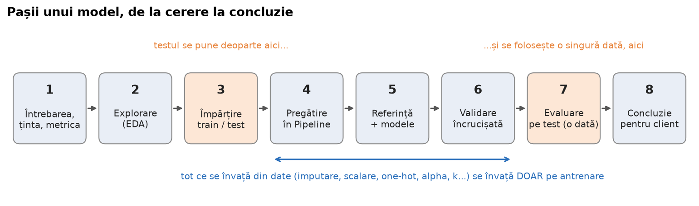

| # | Pas | Ce faci | Ce verifici |
|---|---|---|---|
| 1 | **Întrebarea, ținta, metrica** | Traduci cererea clientului într-o țintă: un număr (**regresie**) sau o categorie (**clasificare**). Alegi metrica **înainte** de a antrena, din costul greșelilor. | Întrebarea are o decizie legată de ea („dacă X, facem Y”)? Ce greșeală costă mai mult? |
| 2 | **Explorare (EDA)** | Dimensiuni, tipuri, lipsuri, distribuții, valori aberante, dezechilibrul țintei. | Coloane numerice citite ca text (`TotalCharges`)? ID-uri? Coloane constante? Coloane care „știu viitorul”? |
| 3 | **Împărțire train / test** | `train_test_split(X, y, test_size=0.2, random_state=42)`; la clasificare și `stratify=y`. | Împărțirea e făcută **înainte** de orice transformare învățată din date. |
| 4 | **Pregătire în `Pipeline`** | Imputare, codificare, scalare, toate *în* `Pipeline`, învățate doar pe antrenare. | Nimic nu e calculat pe tot tabelul înainte de împărțire (*data leakage*). |
| 5 | **Referință + modele** | Începi cu modelul banal (`DummyRegressor` = media, `DummyClassifier` = clasa majoritară), apoi cel puțin trei modele, cu **același** protocol. | Fiecare model bate clar referința? |
| 6 | **Validare încrucișată** | Compari modelele și alegi hiperparametrii (`alpha`, `k`, `max_depth`, `C`) pe antrenare, prin validare încrucișată. | Valoarea aleasă nu e la marginea listei încercate. |
| 7 | **Evaluare pe test, o singură dată** | Modelul ales se evaluează o dată pe test; raportezi antrenare **și** test. | Diferență mare antrenare-test = supraînvățare. |
| 8 | **Concluzie pentru client** | Recomandarea cu o cifră, cât de sigur e rezultatul, limitele (vezi partea 5). | Fiecare cifră din concluzie apare în rezultate. |

**Cele trei seturi de date** (`curs-06`, capitolul 1)

| Set | Rol | Cine îl „vede” |
|---|---|---|
| **antrenare** | modelul învață din el | modelul |
| **validare** (sau validare încrucișată pe antrenare) | alegem modelul, hiperparametrii și pragul | noi, de câte ori e nevoie |
| **test** | estimarea finală, „examenul” | **o singură dată**, la final |

**Scheletul de cod** (același pentru regresie și clasificare):

```python
import pandas as pd
from seed.date import incarca
from sklearn.model_selection import train_test_split
from sklearn.pipeline import Pipeline
from sklearn.compose import make_column_transformer, make_column_selector
from sklearn.impute import SimpleImputer
from sklearn.preprocessing import OneHotEncoder, StandardScaler
from sklearn.linear_model import LogisticRegression

df = incarca("lab-set1")[0]
df["TotalCharges"] = pd.to_numeric(df["TotalCharges"], errors="coerce").fillna(0)   # text → număr; gol = client nou
X = df.drop(columns=["customerID", "Churn"])            # fără ID și fără țintă
y = (df["Churn"] == "Yes").astype(int)
X_train, X_test, y_train, y_test = train_test_split(X, y, test_size=0.2, stratify=y, random_state=42)

numere = make_column_selector(dtype_include="number")
text = make_column_selector(dtype_exclude="number")
pregatire = make_column_transformer(
    (Pipeline([("lipsuri", SimpleImputer(strategy="median")), ("scalare", StandardScaler())]), numere),
    (Pipeline([("lipsuri", SimpleImputer(strategy="most_frequent")),
               ("onehot", OneHotEncoder(handle_unknown="ignore", sparse_output=False))]), text))

model = Pipeline([("prep", pregatire), ("model", LogisticRegression(max_iter=1000))])
model.fit(X_train, y_train)                             # TOT ce se învață, se învață aici, doar pe antrenare
print(model.score(X_train, y_train), model.score(X_test, y_test))
```

**Ce metrică alegem** (`curs-06`, capitolul 4): regula este să o alegi **înainte** de a antrena, pornind de la costul greșelilor.

| Metrica | Răspunde la întrebarea | Când o alegem |
|---|---|---|
| **MAE** | cât greșesc, în medie, în unitățile țintei (lei, $)? | regresie; cea mai ușor de explicat |
| **RMSE** | la fel, dar greșelile mari contează mai mult | regresie, când o greșeală mare e gravă |
| **R²** | cât din variație explic? (media dă ≈ 0) | regresie, ca reper relativ |
| **acuratețe** | ce procent de decizii sunt corecte? | clase echilibrate, greșeli cu cost similar; se citește *față de clasa majoritară* |
| **precizie** | când spun „da”, cât de des am dreptate? | o alarmă falsă costă mult (blocăm un card bancar) |
| **recall** | din cazurile reale, câte găsesc? | un caz ratat costă mult (boală, fraudă, client pierdut) |
| **F1** | echilibru între precizie și recall | clase dezechilibrate, fără costuri cunoscute |
| **ROC-AUC** | cât de bine ordonează modelul cazurile după risc? | comparăm modele independent de prag (0,5 = la întâmplare) |
| **profit / cost** | cât câștigă sau pierde afacerea? | **când clientul ne poate da cifrele** (vezi 4.4) |

**Matricea de confuzie** arată direct cele două feluri de greșeli; cere-o mereu pentru modelul ales.

*Mai mult:* `curs-04a` (MAE, R², referința), `curs-05a` (acuratețea care minte, matricea de confuzie, ROC), `curs-06` (metrica din problemă).

---

## 2. Pregătirea datelor pentru modelare

**Regula de aur:** orice transformare care *învață ceva din date* (media, mediana, abaterea standard, lista de categorii, numărul de exemple din fiecare clasă) se învață **doar pe antrenare** și se aplică apoi pe test. În practică: o pui în `Pipeline`, nu o rulezi pe tot tabelul.

### 2.1 Scalarea

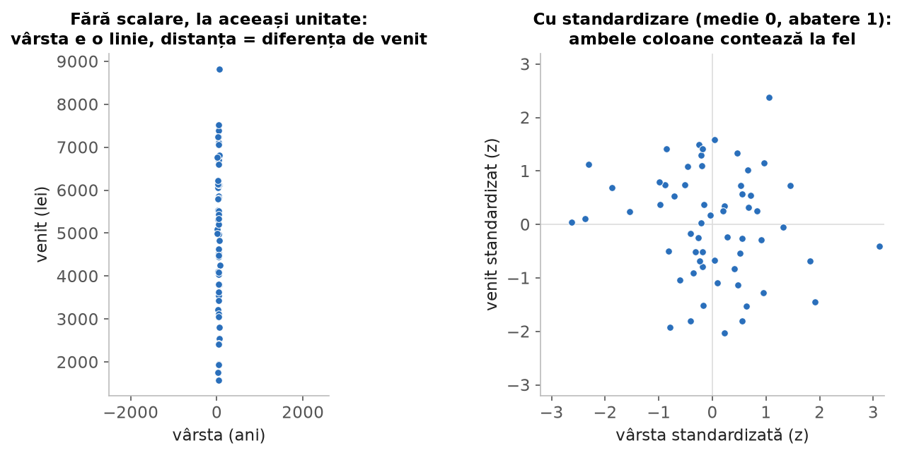

Coloanele au unități diferite (ani, lei, luni). Pentru modelele care măsoară **distanțe** sau **penalizează coeficienții**, coloana cu cifre mari domină pe nedrept.

| Metodă | Ce face | Când o folosești |
|---|---|---|
| `StandardScaler` | medie 0, abatere standard 1 | alegerea implicită |
| `MinMaxScaler` | aduce valorile în [0, 1] | când ai nevoie de un interval fix; sensibilă la valori extreme |
| `RobustScaler` | folosește mediana și IQR | când există valori aberante |
| `np.log1p` / `TransformedTargetRegressor` | comprimă valorile mari | ținte sau coloane foarte asimetrice (prețuri, venituri) |

| **Cer scalare** | **Nu au nevoie** |
|---|---|
| kNN, SVM, regresia logistică (are regularizare), Ridge / Lasso / Elastic Net, PCA, k-means | arbori de decizie, random forest, gradient boosting (o întrebare „vechime < 6?” nu depinde de unități) |

**Bune practici**
- Scalarea stă în `Pipeline`, după imputare. Dacă standardizezi tot tabelul înainte de împărțire, media și abaterea „văd” testul.
- Nu scala ținta la clasificare. La regresie, dacă transformi ținta (log), raportezi eroarea înapoi în unitățile originale.
- Coloanele one-hot (0/1) pot fi lăsate nescalate sau scalate; important e să fie consecvent pentru toate modelele comparate.

### 2.2 Codificarea variabilelor categoriale

Modelele lucrează doar cu numere. Cum transformi textul în numere depinde de **tipul** categoriei.

| Tip | Exemplu | Metodă | Atenție |
|---|---|---|---|
| **Nominală** (fără ordine) | `PaymentMethod`, `Contract` | `OneHotEncoder(handle_unknown="ignore")`: o coloană 0/1 pentru fiecare categorie | categoriile noi din test sunt ignorate, nu dau eroare |
| **Ordinală** (cu ordine) | „mic < mediu < mare”, nivel de educație | `OrdinalEncoder(categories=[["mic", "mediu", "mare"]])` | dă ordinea **explicit**; implicit e alfabetică |
| **Ținta** la clasificare | „Yes”/„No” | `(y == "Yes").astype(int)` sau `LabelEncoder` | `LabelEncoder` e **doar pentru țintă**, nu pentru predictori |
| **Multe categorii** (sute: oraș, cod produs) | `ZipCode` | grupezi categoriile rare în „Altele” (`OneHotEncoder(min_frequency=...)`) sau `TargetEncoder` | `TargetEncoder` folosește ținta: doar în `Pipeline`, altfel e scurgere de informație |

**Bune practici**
- **Cifrele nu înseamnă automat număr:** `MSSubClass` (20, 60, 190) sau `SeniorCitizen` sunt categorii. 60 nu e „de trei ori” 20.
- **Numerele stocate ca text** se convertesc înainte: `pd.to_numeric(df["TotalCharges"], errors="coerce")`.
- **ID-urile** nu se codifică, se elimină: un model le poate memora, dar nu spun nimic despre un client nou.
- O categorie **rară** cu coeficient sau importanță mare e suspectă: verifică câte rânduri are (exemplul `RoofMatl_ClyTile`, o singură casă).

### 2.3 Imputarea valorilor lipsă

Întâi întrebarea: **de ce lipsește valoarea?** Răspunsul alege metoda, nu comoditatea.

| Situație | Exemplu | Ce faci |
|---|---|---|
| Lipsa **înseamnă ceva** | `PoolQC` lipsă = „nu are piscină”; `TotalCharges` gol = client nou, a plătit 0 | completezi cu valoarea corectă („Lipsă”, 0) |
| Lipsă întâmplătoare, coloană numerică | venit necompletat | `SimpleImputer(strategy="median")`: mediana e robustă la valori extreme |
| Lipsă întâmplătoare, coloană categorială | metodă de plată necompletată | `SimpleImputer(strategy="most_frequent")` sau `strategy="constant", fill_value="Lipsă"` |
| Lipsa poate fi un semnal | clientul n-a vrut să-și spună venitul | `SimpleImputer(..., add_indicator=True)` adaugă o coloană „lipsea” |
| Coloana e mai mult goală | peste ~20-50% lipsă | o elimini sau o transformi în „are / nu are” |
| Lipsește **ținta** | prețul unei case necunoscut | rândul nu poate fi folosit nici la antrenare, nici la evaluare |

**Bune practici**
- Mediana se calculează **pe antrenare** (în `Pipeline`). Imputarea pe tot tabelul înainte de împărțire e scurgere de informație.
- Notează câte rânduri și coloane ai eliminat și de ce; clientul trebuie să știe.
- `KNNImputer` sau `IterativeImputer` sunt mai fine, dar rar schimbă mult rezultatul; începe simplu.

### 2.4 Balansarea claselor (date dezechilibrate)

Când o clasă e rară (plecări 26%, fraude 0,1%, boli rare), modelul învață că „nimeni nu e în clasa rară” are acuratețe mare. Ordinea recomandată a remediilor:

| # | Remediu | Cum | De ce |
|---|---|---|---|
| 1 | **Împărțire stratificată** | `train_test_split(..., stratify=y)`; `StratifiedKFold` în validare | aceeași proporție a clasei rare în antrenare, test și fiecare fold |
| 2 | **Metrica potrivită** | recall, precizie, F1, AUC, matricea de confuzie, nu acuratețea | acuratețea ascunde exact clasa care te interesează |
| 3 | **Ponderi pe clase** | `LogisticRegression(class_weight="balanced")`, la fel pentru arbori, random forest, SVM | greșelile pe clasa rară costă mai mult; nu inventezi date |
| 4 | **Reglarea pragului** | `model.predict_proba(X)[:, 1] >= 0.3` în loc de 0,5 | alegi echilibrul recall/precizie după costuri (modulul 6) |
| 5 | **Reeșantionare** | subeșantionare a clasei mari sau SMOTE (pachetul `imbalanced-learn`, cu `imblearn.pipeline.Pipeline`) | ultima soluție; utilă la dezechilibre foarte mari |

**Bune practici**
- Reeșantionarea se face **doar pe antrenare**, niciodată pe test: testul trebuie să arate ca lumea reală.
- SMOTE înainte de împărțire sau de validarea încrucișată copiază informație în test: scorul devine fals de bun.
- Compară întotdeauna cu referința (clasa majoritară): acuratețe 0,735, **recall 0**.

### 2.5 Scurgerea de informație (*data leakage*)

**Data leakage** apare când modelul primește la antrenare o informație pe care **nu o va avea** în momentul deciziei. Rezultatul: un scor excelent în notebook și un model inutil în realitate. Pe Telco, o coloană „a depus cerere de reziliere” urcă ROC-AUC de la **0,843 la 0,979** (`curs-06`, capitolul 6).

| Tip | Exemplu | Cum o eviți |
|---|---|---|
| **Coloane „din viitor”** | data cererii de reziliere, „motiv închidere cont”, apeluri la departamentul de reziliere | întrebi pentru fiecare coloană: *aș avea-o în momentul în care trebuie să decid?* |
| **Transformări pe tot setul** | scalare, imputare, one-hot, SMOTE calculate înainte de împărțire | totul în `Pipeline`, învățat doar pe antrenare |
| **Testul folosit la alegeri** | alegi modelul, `alpha` sau pragul după scorul pe test | alegerile se fac pe validarea încrucișată; testul doar confirmă |
| **Identificatori** | `customerID`, `Id`, numărul facturii | se elimină înainte de modelare |
| **Rânduri duplicate** | același client în antrenare și în test | elimini duplicatele înainte de împărțire |
| **Ordinea în timp** | antrenezi pe 2025 și „prezici” 2024 | pentru date în timp: antrenare pe trecut, test pe perioada următoare (`TimeSeriesSplit`) |

**Semnal de alarmă:** un scor aproape perfect (AUC peste 0,95, $R^2$ peste 0,99) pe o problemă de business reală nu e un motiv de bucurie. Caută coloana care „știe” răspunsul: importanța foarte mare a unei singure coloane e de obicei indiciul.

---

## 3. Cum decid modelele

Toate imaginile de mai jos folosesc aceeași problemă: un client **pleacă** (portocaliu) sau **rămâne** (albastru), în funcție de *vechime* și *costul lunar*. Fiecare model împarte planul altfel:

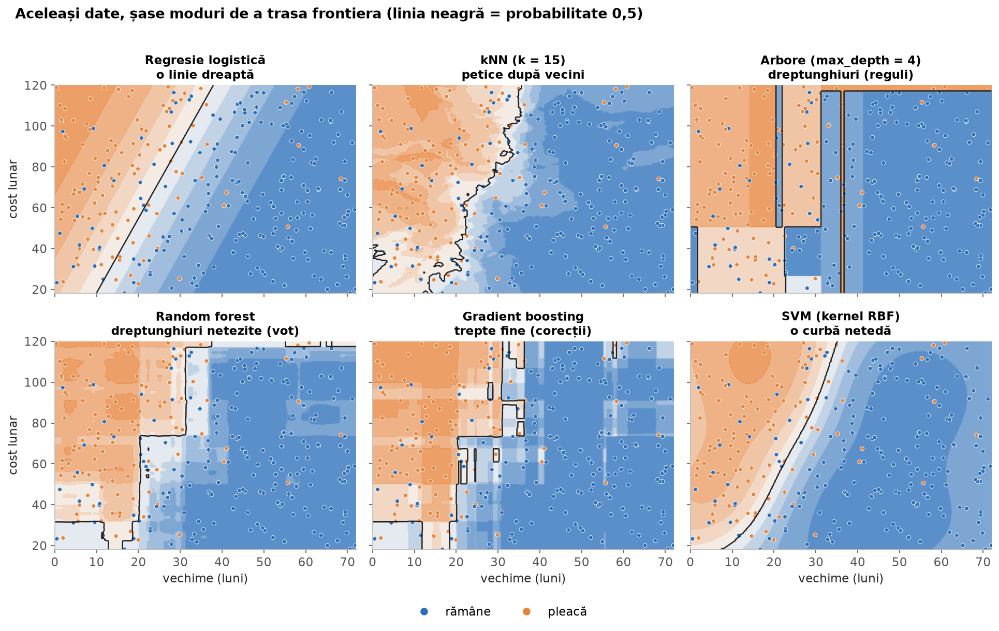

### Regresia liniară (regresie)

**Cum decide:** prețul = intercept + suma (coeficient × valoare). Un coeficient spune cât crește ținta când predictorul crește cu 1 și **ceilalți rămân la fel**.
- **Capcane:** coeficienții nu se citesc izolat (garajul: 66.900 $ singur, 11.200 $ cu celelalte coloane); câteva puncte atipice pot înclina toată dreapta; cu multe coloane și puține rânduri memorează.
- **Regularizarea** ține coeficienții în frâu: **Ridge** îi micșorează, **Lasso** îi poate anula (selectează coloanele), **Elastic Net** combină cele două. Cer scalare; `alpha` se alege prin validare încrucișată.

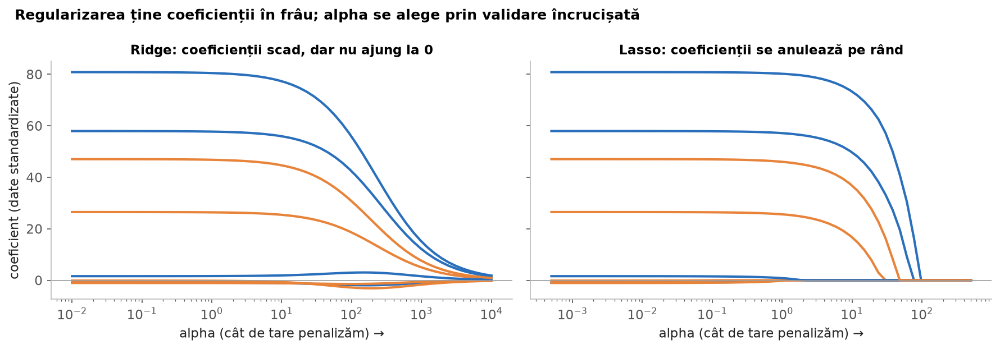

### Regresia logistică

**Cum decide:** calculează un scor ca regresia liniară, apoi **sigmoida** îl transformă într-o probabilitate între 0 și 1. Pragul (implicit 0,5) transformă probabilitatea în clasă. Frontiera este o **linie dreaptă** (un plan, în mai multe dimensiuni).

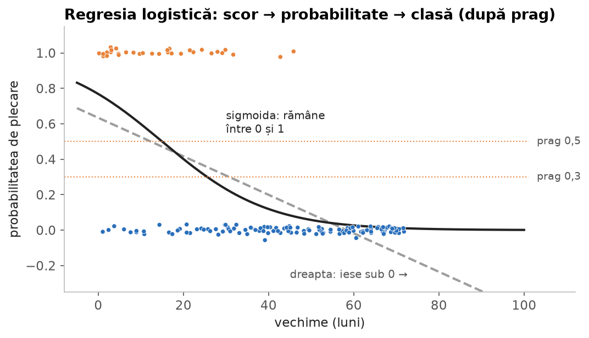

- **Hiperparametru:** `C` (mic = regularizare puternică). Cere scalare.
- **Puncte forte:** rapidă, ușor de explicat, probabilități bune; pe Telco a câștigat arena (AUC 0,842).
- **Capcană:** pragul 0,5 nu e o lege; e o decizie de business ascunsă.

### kNN (k vecini cei mai apropiați)

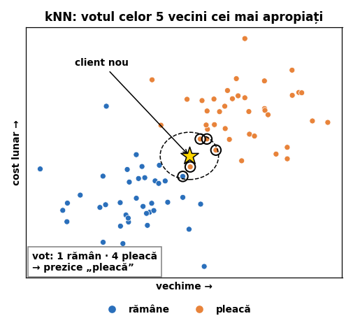

**Cum decide:** pentru un client nou, caută cei `k` clienți cei mai **asemănători** din antrenare și ia votul lor. Nu „învață” nimic: ține minte toată antrenarea.
- **Hiperparametru:** `n_neighbors` (k mic = hartă pătată, memorează; k mare = hartă netedă).
- **Capcane:** **fără scalare** decide coloana cu cifre mari (pe Telco: acuratețea crește, dar recall-ul scade de la 0,57 la 0,39); lent pe seturi mari.

### Arborele de decizie

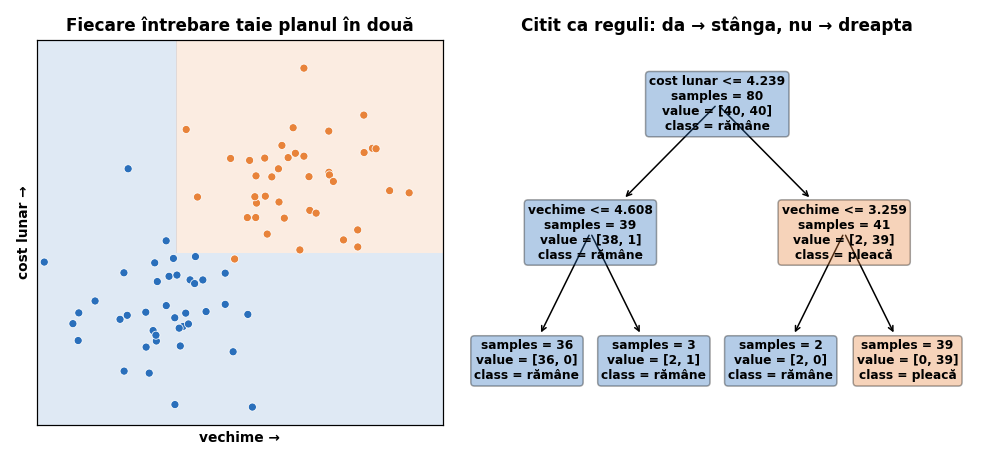

**Cum decide:** pune întrebări da/nu („contract lunar?”, „vechime ≤ 13 luni?”), fiecare tăind planul în două. Rezultatul e un set de **reguli** citibile. Alege întrebarea care separă cel mai bine clasele (impuritate Gini).
- **Hiperparametri:** `max_depth`, `min_samples_leaf`.
- **Capcană:** fără limită de adâncime memorează tot: pe Telco 0,998 pe antrenare și 0,720 pe test, **sub referință**. Nu cere scalare.

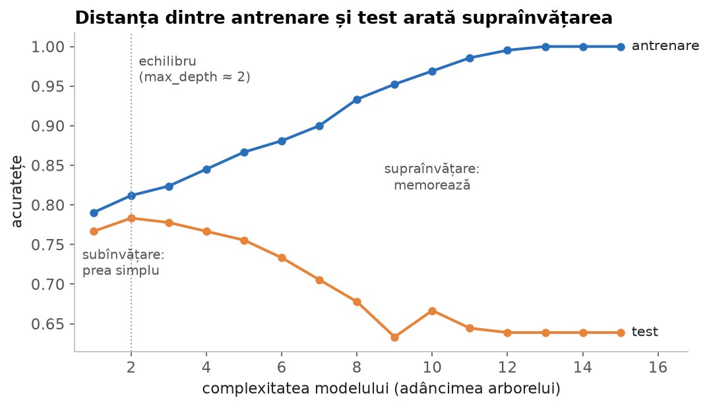

### Random forest (pădure aleatoare)

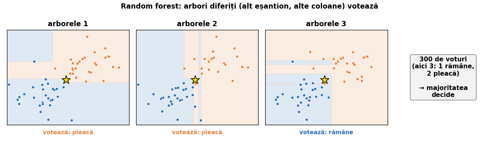

**Cum decide:** sute de arbori adânci, fiecare antrenat pe un eșantion diferit de rânduri și de coloane (*bagging*); decizia e **votul** lor. Greșelile arborilor individuali se anulează reciproc.
- **Hiperparametri:** `n_estimators` (mai mulți = mai stabil, nu mai „supraînvățat”), `max_features`, `min_samples_leaf`.
- **De știut:** acuratețea pe antrenare e aproape 1, dar testul se ține bine: un scor mare pe antrenare **nu e singur** o dovadă de supraînvățare. Importanța coloanelor arată ce *folosește* modelul, nu ce *cauzează* rezultatul.

### Gradient boosting

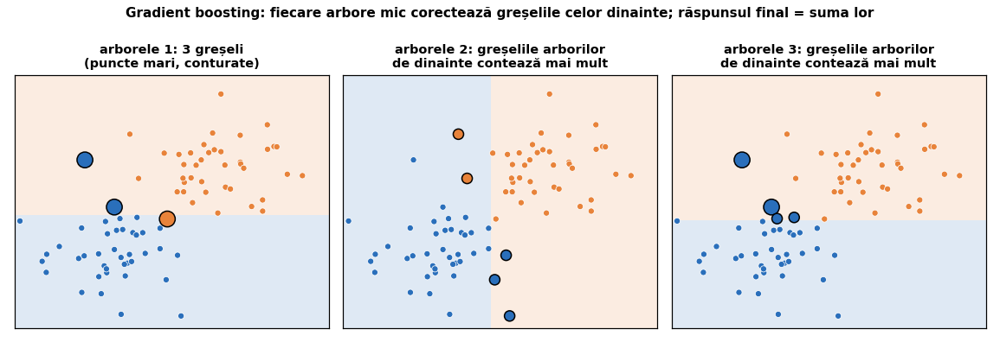

**Cum decide:** arbori mici, construiți **unul după altul**; fiecare corectează greșelile celor de dinainte (*boosting*). Adesea cel mai precis model pe date tabelare.
- **Hiperparametri:** `learning_rate` (pas mic = mai mulți arbori, mai stabil), `max_iter` / `n_estimators`, `max_depth`. În scikit-learn: `HistGradientBoostingClassifier` (rapid, acceptă valori lipsă).
- **Capcană:** cu prea mulți arbori și pas mare poate memora; se reglează prin validare încrucișată.

### SVM (mașini cu vectori suport)

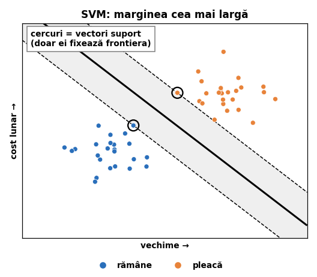

**Cum decide:** caută frontiera cu **marginea cea mai largă** între clase; contează doar punctele de lângă frontieră (vectorii suport). Cu un **kernel** (implicit RBF), frontiera poate fi curbă:

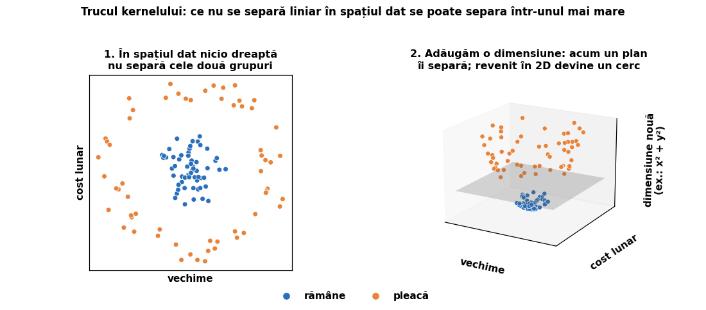

- **Hiperparametri:** `C` (mare = margine îngustă, frontieră sinuoasă), `gamma` (mare = frontieră foarte locală).
- **Capcane:** cere scalare; nu dă direct probabilități; lent pe sute de mii de rânduri; greu de explicat.

### Modelele pe scurt

| Model | Cum decide | Scalare? | Hiperparametri principali | Punct forte | Capcana tipică |
|---|---|---|---|---|---|
| Regresie liniară / Ridge / Lasso | sumă ponderată | da (cu regularizare) | `alpha` | explicabil, coeficienți | coeficienți citiți izolat; puncte atipice |
| Regresie logistică | sumă ponderată → sigmoidă | da | `C` | explicabil, probabilități bune | frontieră doar dreaptă |
| kNN | votul vecinilor | **obligatoriu** | `n_neighbors` | intuitiv | fără scalare; lent |
| Arbore de decizie | întrebări da/nu | nu | `max_depth`, `min_samples_leaf` | reguli citibile | memorează fără limită |
| Random forest | votul a sute de arbori | nu | `n_estimators`, `max_features` | robust, puțin reglaj | greu de explicat |
| Gradient boosting | arbori care se corectează | nu | `learning_rate`, `max_iter`, `max_depth` | adesea cel mai precis | se reglează cu grijă |
| SVM | marginea cea mai largă | **obligatoriu** | `C`, `gamma`, `kernel` | bun pe date medii | lent, greu de explicat |

**La egalitate** (diferențe de câteva miimi, în marja de variație a împărțirii), câștigă **modelul mai ușor de explicat**. Pentru decizii care afectează oameni (credit, angajare, diagnostic), un model simplu și explicabil e adesea preferat unuia puțin mai precis.

*Mai mult:* `curs-04a`, `curs-04b` (regresie, regularizare), `curs-05a` (regresia logistică), `curs-05b` (celelalte modele și arena); `extra-05-svm` (SVM în detaliu).

---

## 4. Tehnici de antrenare

### 4.1 Validarea încrucișată

O singură împărțire poate fi norocoasă sau ghinionistă: pe casele din Ames, $R^2$ pe test variază între 0,50 și 0,85 doar din `random_state`; pe Telco, acuratețea variază între 0,795 și 0,812, iar validarea încrucișată dă **0,802 ± 0,014**. Validarea încrucișată împarte **antrenarea** în *k* părți și repetă antrenarea de *k* ori, de fiecare dată cu altă parte pentru validare.

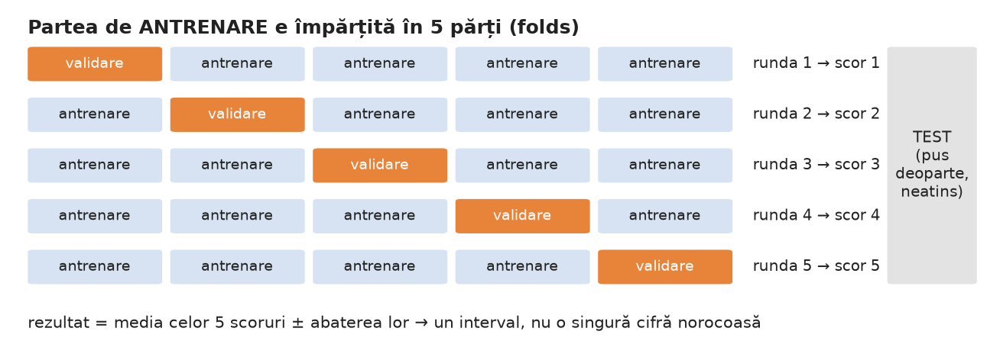

```python
from sklearn.model_selection import cross_validate, StratifiedKFold

cv = StratifiedKFold(n_splits=5, shuffle=True, random_state=42)    # la regresie: KFold
rez = cross_validate(model, X_train, y_train, cv=cv, scoring=["roc_auc", "recall"], return_train_score=True)
print(rez["test_roc_auc"].mean(), "±", rez["test_roc_auc"].std())
```

**Bune practici**
- Validarea încrucișată se face **doar pe antrenare**; testul rămâne neatins până la final.
- Treci în validare **tot `Pipeline`-ul**, nu doar modelul: așa imputarea și scalarea se reînvață în fiecare fold, fără scurgere de informație.
- La clasificare folosește `StratifiedKFold`; pentru date în timp, `TimeSeriesSplit` (nu amesteci viitorul în antrenare).
- Raportează media **și** abaterea: un interval, nu o cifră.

### 4.2 Grid search (`GridSearchCV`)

Încearcă **toate combinațiile** dintr-o listă de valori, fiecare evaluată prin validare încrucișată, și păstrează combinația cu scorul mediu cel mai bun.

```python
from sklearn.model_selection import GridSearchCV
from sklearn.svm import SVC

model = Pipeline([("prep", pregatire), ("model", SVC())])
grila = {"model__C": [0.1, 1, 10, 100],                # numele pasului + __ + parametrul
         "model__gamma": [0.001, 0.01, 0.1, 1]}
cautare = GridSearchCV(model, grila, cv=cv, scoring="roc_auc", n_jobs=-1)
cautare.fit(X_train, y_train)
print(cautare.best_params_, cautare.best_score_)
print("test:", cautare.score(X_test, y_test))           # o singură dată, la final
```

**Bune practici**
- Pentru `C`, `alpha`, `gamma`, `learning_rate` folosește valori pe **scară logaritmică** (0,01, 0,1, 1, 10...), nu 1, 2, 3.
- Dacă valoarea aleasă e **la marginea grilei**, grila era prea mică: extinde-o în acea direcție.
- Costul crește multiplicativ: 4 parametri × 5 valori × 5 folduri = 3.125 de antrenări. Pentru spații mari: `RandomizedSearchCV` (încercări aleatoare, `n_iter=30`) sau Optuna.
- `scoring` se alege după problema de business (`"recall"`, `"roc_auc"`, `"neg_mean_absolute_error"`), nu implicit.

### 4.3 Optuna (căutare inteligentă)

Grid search încearcă orbește toate combinațiile. **Optuna** învață din încercările anterioare: după câteva încercări de explorare, propune valori în zonele unde scorul a fost bun (algoritmul TPE).

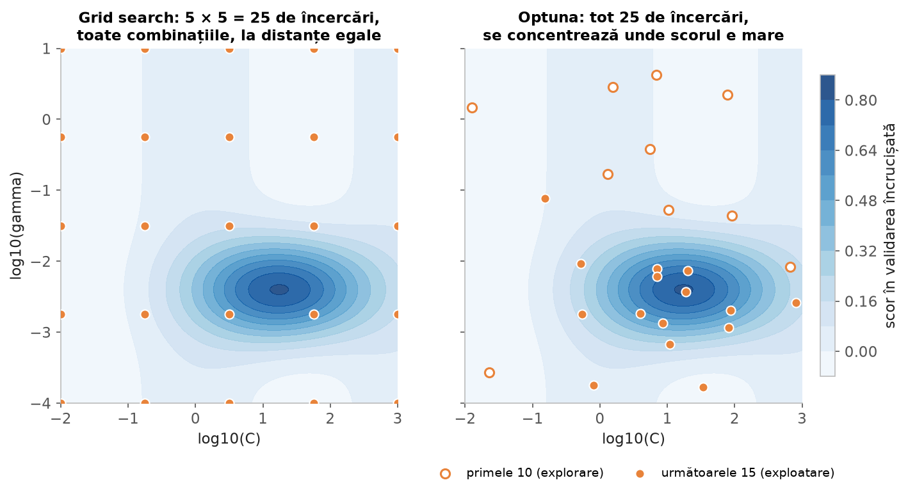

Trei piese: **funcția obiectiv** (construiește un model din valorile propuse și întoarce scorul din validarea încrucișată), **studiul** (direcția: maximizăm sau minimizăm) și **bugetul** (număr de încercări sau timp). Ca la seminarul 6, Optuna poate alege și **tipul de model**, nu doar setările lui:

```python
import optuna
from sklearn.model_selection import cross_val_score
from sklearn.ensemble import HistGradientBoostingClassifier
optuna.logging.set_verbosity(optuna.logging.WARNING)

METRICA = "roc_auc"                                     # aleasă din problemă, ÎNAINTE de căutare

def construieste_model(trial):
    tip = trial.suggest_categorical("model", ["logreg", "boosting"])
    if tip == "logreg":
        m = LogisticRegression(C=trial.suggest_float("C", 1e-3, 1e2, log=True), max_iter=1000)
    else:
        m = HistGradientBoostingClassifier(
            learning_rate=trial.suggest_float("learning_rate", 0.01, 0.3, log=True),
            max_depth=trial.suggest_int("max_depth", 2, 8),
            min_samples_leaf=trial.suggest_int("min_samples_leaf", 10, 100), random_state=42)
    return Pipeline([("prep", pregatire), ("model", m)])

def obiectiv(trial):
    return cross_val_score(construieste_model(trial), X_train, y_train, cv=cv, scoring=METRICA).mean()

studiu = optuna.create_study(direction="maximize", sampler=optuna.samplers.TPESampler(seed=42))
studiu.optimize(obiectiv, n_trials=60, timeout=60)      # buget: 60 de încercări sau un minut
print(studiu.best_params, studiu.best_value)

# modelul câștigător, refăcut din cei mai buni parametri, antrenat pe toată antrenarea, evaluat O DATĂ pe test
cel_mai_bun = construieste_model(optuna.trial.FixedTrial(studiu.best_params)).fit(X_train, y_train)
print("test:", cel_mai_bun.score(X_test, y_test))
```

**Bune practici**
- Funcția obiectiv întoarce scorul din **validarea încrucișată pe antrenare**; testul nu apare nicăieri în ea.
- Metrica optimizată e cea argumentată din problemă (recall, AUC, profit), nu acuratețea implicită.
- Fixează `seed` în sampler și `random_state` în model, ca rezultatul să fie reproductibil.
- Intervalele pentru parametrii „multiplicativi” se dau cu `log=True`.
- `optuna.visualization.plot_optimization_history(studiu)` arată dacă mai merită încercări; `plot_param_importances(studiu)` arată ce parametri contează; `studiu.trials_dataframe()` le dă pe toate ca tabel.
- Pentru studii lungi: `optuna.create_study(storage="sqlite:///studii.db", study_name="...")` salvează încercările (studiul poate fi reluat), iar `optuna-dashboard` le arată în browser (vezi `extra-06-optuna-dashboard`).
- La multe încercări, Optuna poate „supraînvăța” validarea: diferențe foarte mici între încercări nu înseamnă un model mai bun. Diferența dintre scorul CV și scorul pe test trebuie să o poți explica.

### Grid search, căutare aleatoare sau Optuna?

| | `GridSearchCV` | `RandomizedSearchCV` | Optuna |
|---|---|---|---|
| Cum caută | toate combinațiile | combinații aleatoare | învață din încercările anterioare |
| Bun pentru | 1-2 parametri, puține valori | spații mari, buget fix | spații mari, antrenări costisitoare |
| Avantaj | simplu, exhaustiv | controlezi bugetul (`n_iter`) | găsește mai repede zona bună |
| Dezavantaj | explodează combinatoric | nu învață din rezultate | pachet separat, mai mult cod |

### 4.4 Pragul de decizie ales după costuri

Un clasificator dă o **probabilitate**; pragul o transformă în decizie („trimitem oferta?”). Pragul 0,5 nu e o lege: e o decizie de business, și se alege din **costurile clientului**, nu din statistică.

**Rețeta** (`curs-06`, capitolul 3):
1. Clientul dă cifrele. Exemplul Telco: oferta costă 50 lei, un client păstrat aduce 600 lei pe an, oferta convinge 1 din 2.
2. Traduci matricea de confuzie în bani: **TP** = 0,5 × 600 − 50 = **+250 lei**; **FP** = **−50 lei**; FN și TN = 0 (față de „nu facem nimic”).
3. Calculezi profitul pentru fiecare prag pe **predicțiile din validarea încrucișată** (pe antrenare) și alegi pragul cu profit maxim.
4. Abia apoi aplici pragul pe test, **o singură dată**.

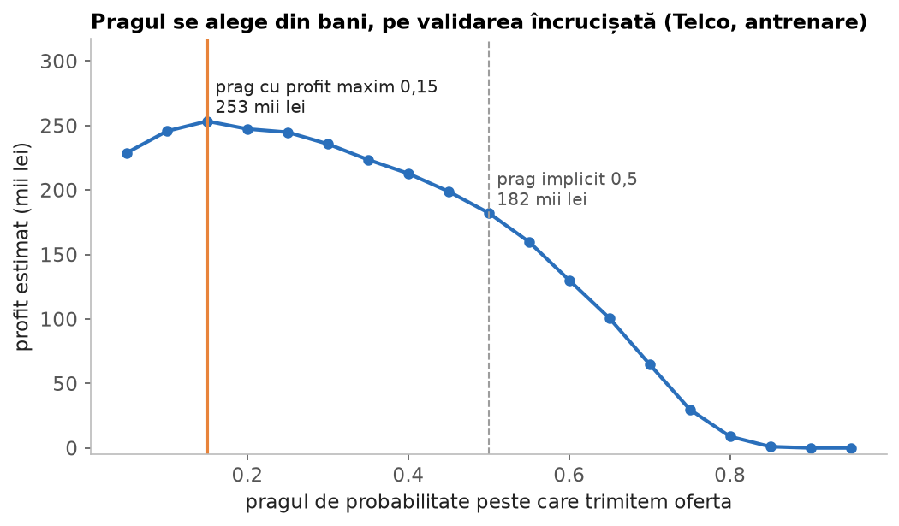

```python
import numpy as np
from sklearn.model_selection import cross_val_predict
from sklearn.metrics import confusion_matrix

CASTIG_TP, COST_FP = 250, -50
model = Pipeline([("prep", pregatire), ("model", LogisticRegression(max_iter=1000))])   # sau modelul ales

def profit(y_adevarat, probabilitati, prag):
    tn, fp, fn, tp = confusion_matrix(y_adevarat, (probabilitati >= prag).astype(int)).ravel()
    return tp * CASTIG_TP + fp * COST_FP

p_cv = cross_val_predict(model, X_train, y_train, cv=cv, method="predict_proba")[:, 1]
praguri = np.round(np.arange(0.05, 0.96, 0.05), 2)
prag_optim = praguri[np.argmax([profit(y_train, p_cv, p) for p in praguri])]

p_test = model.fit(X_train, y_train).predict_proba(X_test)[:, 1]   # o singură dată, la final
print(prag_optim, profit(y_test, p_test, prag_optim), profit(y_test, p_test, 0.5))
```

**Rezultatul din `curs-06`** (test, 1.409 clienți, împărțire cu `random_state=17`; cu scheletul de aici, `random_state=42`, cifrele diferă cu ~1.000 lei, iar pragul rămâne 0,15): pragul **0,15** trimite 780 de oferte, prinde **93%** din plecări, cu precizie 44%: profit **64.800 lei**, față de 47.650 lei la pragul 0,5 (313 oferte, recall 56%).

**Bune practici**
- Când un client pierdut costă mult mai mult decât o ofertă, pragul optim e **sub 0,5**; dacă oferta e scumpă, pragul crește.
- Profitul pe validare (≈ 253 mii lei, pe cei 5.634 de clienți de antrenare) și cel pe test (64.800 lei, pe 1.409) nu se compară direct: sunt mulțimi de mărimi diferite.
- Spune în raport **ipotezele** (costul ofertei, valoarea clientului, rata de succes): dacă se schimbă, pragul se recalculează.

---

## 5. De la model la raport

Clientul nu plătește pentru un model, ci pentru **o decizie mai bună** (`curs-07`).

**De la cerere la întrebare.** O întrebare bună e **specifică** (cine, ce, când), **măsurabilă** și are o **decizie** legată de ea: *dacă răspunsul este X, facem Y*.

| Ce spune clientul | Întrebarea analitică | Tipul problemei | Cum măsurăm succesul |
|---|---|---|---|
| „Pierdem prea mulți abonați.” | Care clienți vor pleca luna viitoare? | clasificare | profitul campaniei, recall |
| „Nu știu cât să cer pe o casă.” | Ce preț are o locuință cu aceste caracteristici? | regresie | eroarea medie în lei (MAE) |
| „Vreau oferte personalizate.” | Ce grupuri de clienți seamănă între ele? | clusterizare | grupuri stabile și interpretabile |
| „Ce produse să pun alături?” | Ce produse se cumpără împreună? | reguli de asociere | lift, creșterea coșului mediu |

**Raportul, în ordinea piramidei** (concluzia întâi):
1. **Recomandarea**, într-o frază, cu o cifră: *„Trimiteți oferta celor 780 de clienți marcați; profit estimat 64.800 lei.”*
2. **Contextul:** întrebarea și datele (perioadă, câte înregistrări, sursa).
3. **Dovezile:** 2-3 rezultate, fiecare cu un grafic al cărui titlu spune concluzia.
4. **Cât de sigur e:** performanța pe test, comparată cu modelul de referință.
5. **Limitele și ipotezele:** ce nu poate spune analiza.
6. **Pașii următori:** ce decizie, cine o ia, cum se verifică efectul.

**Reguli de scriere:** nicio cifră fără unitate și fără comparație („acuratețe 80%” → „găsim 4 din 5 clienți care pleacă, față de 0 fără model”); fără termeni tehnici nedefiniți.

**După raport.** Unde ajunge rezultatul (listă lunară, câmp în CRM, raport BI)? Cât de des se recalculează? Cum aflăm că modelul s-a stricat (*data drift*: comparăm lunar performanța pe date noi cu cea de la test)? Cine îl reantrenează?

**Etică.** Doar datele necesare scopului (GDPR); datele personale nu se trimit în asistenți AI publici; un model poate reproduce nedreptăți din datele istorice, deci verifici performanța pe grupuri (vârstă, gen, zonă).

---

## Lista de verificare înainte de a preda

**Date și pregătire**
- [ ] ID-urile și ținta nu sunt printre predictori; coloanele numerice stocate ca text au fost convertite.
- [ ] Fiecare coloană există în momentul deciziei (nicio informație „din viitor”).
- [ ] Împărțirea train/test (stratificată la clasificare, `random_state` cerut) e făcută **înainte** de orice transformare.
- [ ] Imputarea, codificarea și scalarea sunt în `Pipeline`; reeșantionarea (dacă există) doar pe antrenare.

**Modelare și evaluare**
- [ ] Metrica a fost aleasă **înainte** de antrenare, din costul greșelilor.
- [ ] Tabelul de rezultate are un rând **model de referință** și cel puțin trei modele, cu același protocol.
- [ ] Raportezi antrenare **și** test; la clasificare: recall, precizie, AUC și matricea de confuzie, nu doar acuratețea.
- [ ] Hiperparametrii și pragul au fost aleși prin validare încrucișată pe antrenare; valoarea aleasă nu e la marginea grilei.
- [ ] Testul a fost folosit o singură dată, la final.

**Raport și reproductibilitate**
- [ ] Notebook-ul rulează complet după **Restart and run all**, cu `random_state` fixat.
- [ ] Fiecare cifră din raport apare în rezultatele notebook-ului (asistentul AI poate inventa cifre plauzibile).
- [ ] Poți explica, pentru modelul ales, **cum decide** și **ce greșeli face**, în limbajul clientului; limitele sunt spuse cinstit.
